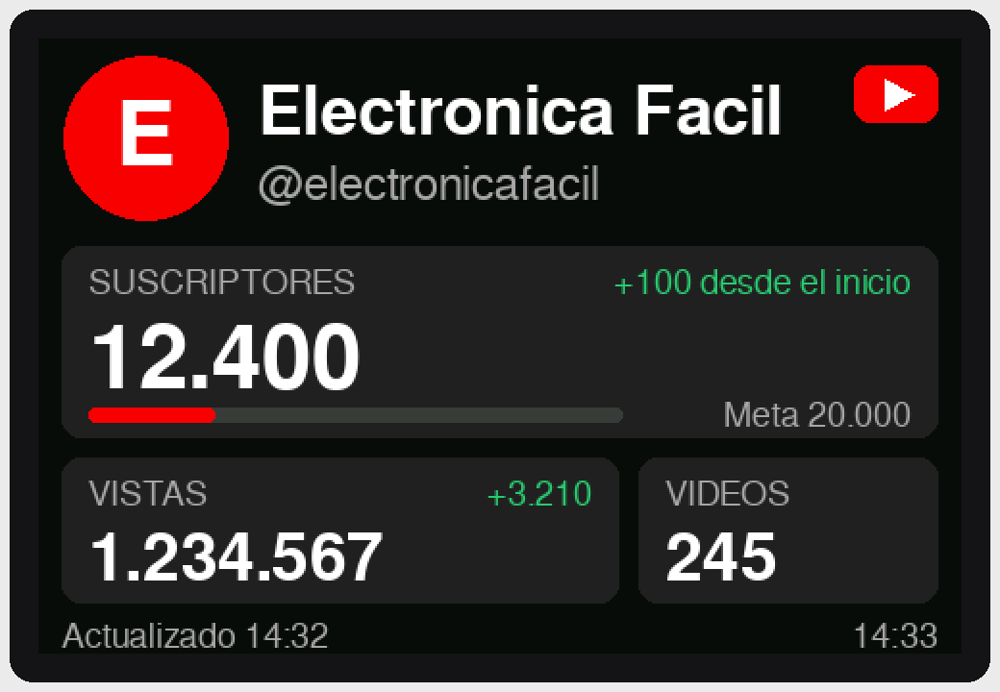

# YouTube Viewer: ESP32-CAM + TFT 4.0" 480x320

Pantalla que muestra los **suscriptores**, las **vistas** y los **vídeos** de un canal de YouTube y se actualiza cada minuto. Muestra también el avatar del canal, cuánto ha cambiado cada cifra desde que se encendió y una barra con el progreso hacia el siguiente hito (1.000, 2.000, 5.000…).

```
┌──────────────────────────────────────────────┐
│ (avatar)  Nombre del canal              [▶] │
│           @handle                           │
│ ┌──────────────────────────────────────────┐ │
│ │ SUSCRIPTORES          +120 desde inicio  │ │
│ │ 12.400                                   │ │
│ │ ███████████░░░░░░░░░░░       Meta 20.000 │ │
│ └──────────────────────────────────────────┘ │
│ ┌───────────────────────┐ ┌───────────────┐ │
│ │ VISTAS         +3.210 │ │ VIDEOS        │ │
│ │ 1.234.567             │ │ 245           │ │
│ └───────────────────────┘ └───────────────┘ │
│ Actualizado 14:32                     14:33 │
└──────────────────────────────────────────────┘
```



*Simulación a escala 2x hecha con `docs/mockup.py` (misma fuente FreeSans y colores RGB565 que el firmware).*

## Viabilidad

**Sí, se puede montar con este hardware**, pero hay que ajustarse a una limitación.

| Aspecto | Valoración |
|---|---|
| ESP32 (WiFi + HTTPS) | ✅ Sobra potencia para consultar la API y dibujar la pantalla. |
| Pantalla ST7796S por SPI | ✅ Solo necesita 4 pines de datos: SCK, MOSI, CS y DC. |
| Pines libres en el ESP32-CAM | ⚠️ Es la limitación principal. La cámara ocupa casi todo, así que en los conectores solo quedan IO0, IO2, IO4, IO12, IO13, IO14, IO15 e IO16, más TX y RX. |
| Pantalla táctil (CTP) | ⚠️ **No se conecta en esta versión.** El I2C del táctil lleva resistencias pull-up y los pines que quedan libres dan problemas con ellas: IO12 en alto al arrancar impide el arranque, IO2 en alto impide flashear, IO4 enciende el LED de flash e IO16 es la PSRAM. Para mostrar estadísticas no hace falta. |
| Lector microSD de la pantalla | ❌ No se usa: no quedan pines y tampoco hace falta. |
| Cámara | No se usa. Puede quedarse conectada; no molesta. |
| API de YouTube | ✅ Es gratis. Cada consulta cuesta 1 unidad de las 10.000 diarias, y una consulta por minuto son 1.440 al día. |
| Precisión | ℹ️ YouTube **redondea los suscriptores a 3 cifras** (12.345 se muestra como 12.300). Las vistas también se actualizan con retraso. Es una limitación de YouTube, no del montaje. |

## Conexiones

La pantalla se conecta a los pines del ESP32-CAM, con el ESP32-CAM puesto sobre la placa ESP32-CAM-MB, que da el USB y la alimentación.

| Pantalla (conector de 14 pines) | ESP32-CAM | Notas |
|---|---|---|
| VCC | **5V** | La pantalla tiene su propio regulador (U1). |
| GND | GND | |
| LCD_CS | **IO15** | |
| LCD_RST | **3V3** | Se hace un reset por software; así ahorramos un pin. |
| LCD_RS (DC) | **IO2** | |
| SDI(MOSI) | **IO13** | |
| SCK | **IO14** | |
| LED | **3V3** | Retroiluminación siempre encendida. |
| SDO(MISO) | sin conectar | |
| CTP_SCL / CTP_RST / CTP_SDA / CTP_INT | sin conectar | Ver la sección de viabilidad. |
| SD_CS | sin conectar | |

> IO13, IO14 e IO15 son los pines nativos del bus HSPI, así que el SPI va a 40 MHz sin pasar por la matriz de GPIO.
> **No metas una microSD en el ESP32-CAM**: su lector usa los mismos pines.

## Puesta en marcha

1. **Clave de API**
   1. Entra en <https://console.cloud.google.com/> y crea un proyecto.
   2. Ve a *APIs y servicios → Biblioteca*, busca **YouTube Data API v3** y pulsa *Habilitar*.
   3. Ve a *Credenciales → Crear credenciales → Clave de API*.
   4. Opcional: restringe la clave a la *YouTube Data API v3*.
2. **Configuración**
   ```bash
   cp include/config.example.h include/config.h
   ```
   Rellena en `include/config.h` el WiFi (solo 2.4 GHz), la clave, el canal (`@handle` o el ID `UC…`) y la zona horaria.
3. **Compilar y flashear** con [PlatformIO](https://platformio.org/) (en VS Code, o desde la terminal):
   ```bash
   cd youtube-viewer
   pio run -t upload
   pio device monitor
   ```
   El ESP32-CAM-MB entra solo en modo de programación. Si falla, mantén pulsado **IO0**, pulsa **RST** y suelta **IO0**.

PlatformIO descarga las librerías por su cuenta: TFT_eSPI, TJpg_Decoder y ArduinoJson. La configuración de la pantalla va en los `build_flags` de `platformio.ini`, así que **no hay que tocar `User_Setup.h`**.

### Si usas el IDE de Arduino

Placa: *AI Thinker ESP32-CAM*, con el paquete de placas esp32 2.0.x. Instala las tres librerías y pon esto en `Arduino/libraries/TFT_eSPI/User_Setup.h`:
```c
#define ST7796_DRIVER
#define TFT_WIDTH 320
#define TFT_HEIGHT 480
#define USE_HSPI_PORT
#define TFT_MISO -1
#define TFT_MOSI 13
#define TFT_SCLK 14
#define TFT_CS   15
#define TFT_DC    2
#define TFT_RST  -1
#define LOAD_GLCD
#define LOAD_FONT2
#define LOAD_GFXFF
#define SPI_FREQUENCY 40000000
```
Después copia `src/*.cpp`, `src/*.h` e `include/config.h` en la carpeta del sketch y renombra `main.cpp` a `youtube-viewer.ino`.

## Problemas frecuentes

| Síntoma | Solución |
|---|---|
| Pantalla blanca | Revisa SCK, MOSI, CS y DC, y que GND sea común. Prueba con `SPI_FREQUENCY=20000000`. |
| Colores cambiados (el rojo sale azul) | Descomenta `-D TFT_RGB_ORDER=TFT_BGR` en `platformio.ini`. |
| Colores en negativo | Descomenta `-D TFT_INVERSION_ON=1`. |
| Imagen boca abajo | En `ui.cpp`, cambia `setRotation(1)` por `setRotation(3)`. |
| Se reinicia al conectar el WiFi (*Brownout detector*) | La alimentación no da suficiente. Usa un cargador USB de 5 V y 1 A o más, y un cable corto. |
| `API 403: … quota` / `API key not valid` | Revisa la clave y que la API esté habilitada. |
| `Canal no encontrado` | Revisa el `@handle`, o usa el ID `UC…` del canal. |

## Nota de seguridad

Las conexiones HTTPS no verifican el certificado (`setInsecure()`), así no hay que actualizar certificados raíz en el firmware. Lo que se consulta son datos públicos; restringe la clave de API a la YouTube Data API para limitar lo que se podría hacer con ella.

## Propuesta: versión táctil (aún no implementada)

Este esquema y estas pantallas son una propuesta: el firmware actual **no** usa el táctil. Antes de conectarlo así hay que hacer el cambio de eFuse que se explica en el esquema.

- Esquema de conexiones con táctil: [`docs/wiring.png`](docs/wiring.png), generado con `docs/wiring.py`.
- Pantallas propuestas (panel, gráfica de vistas y lista de canales): [`docs/preview_touch.png`](docs/preview_touch.png), generadas con `docs/mockup_touch.py`.
